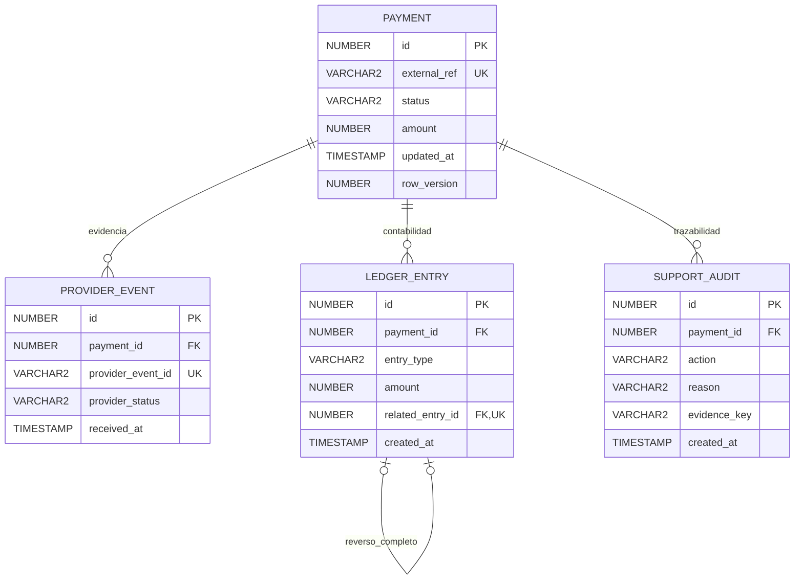

[Volver al ?ndice de documentaci?n](../README.md)

# Modelo de datos y garantías

PAYMENT.external_ref es único, VARCHAR2(40). Estados: PENDING/CONFIRMED/REJECTED. Importe NUMBER(18,2), positivo. row_version es entero no negativo y aumenta una vez por corrección, incluyendo una compensación sin cambio de estado.

PROVIDER_EVENT tiene provider_event_id único VARCHAR2(60); estados APPROVED/DECLINED. Varios APPROVED no demuestran una sola captura. Recibir estados opuestos no define precedencia: requiere revisión manual.

LEDGER_ENTRY admite DEBIT/REVERSAL, con importe positivo. Un DEBIT no tiene relación y su importe debe coincidir con PAYMENT.amount. APPROVED sin ledger requiere revisión manual y no crea débitos. Un REVERSAL apunta a un DEBIT del mismo pago, por el importe completo y sin otro reverso de ese débito. El neto es suma de DEBIT menos suma de REVERSAL. Los movimientos son inmutables; una reversión de una conciliación incorrecta requiere una nueva decisión contable explícita, nunca borrar historial.

SUPPORT_AUDIT registra RESOLVED o MANUAL_REVIEW. La combinación (payment_id,evidence_key) es única; reason es un código estable sin secretos. Una nueva evidencia puede crear otra auditoría. Un pago consistente no genera una auditoría adicional.

| Garantía | H2 local | Oracle preparado |
|---|---|---|
| PK/FK y referencias externas únicas | Schema SQL | Esquema base y preflight |
| Estados, importes, versión y relación por tipo | CHECK | CHECK ENABLE NOVALIDATE para escrituras nuevas |
| Un reverso completo por débito | UNIQUE related_entry_id | Índice único equivalente reutilizado/creado |
| Mismo pago, tipo DEBIT e importe de origen | AccountingGuard antes del INSERT | Trigger compuesto, validación AFTER STATEMENT |
| Inmutabilidad del ledger | Trigger de fila | Trigger BEFORE UPDATE OR DELETE |
| Escritores de eventos/ledger bloquean el padre | AccountingGuard | Guardas de escritura Oracle |
| Auditoría con clave en nuevas filas | NOT NULL | CHECK ENABLE NOVALIDATE; NULL legado conservado |

**Estado de validación:** la columna H2 está comprobada mediante ejecución. Oracle está preparado y revisado estáticamente, pero sus objetos aún requieren compilación y pruebas reales.

El servicio Java usa READ COMMITTED y bloqueo del padre con WAIT 5 antes de leer hijos. Los triggers obligan también al DML directo a tomar ese bloqueo. Mantener una operación por pago o adquirir padres en orden ascendente en lotes. Un deadlock/timeout debe provocar rollback y reintento controlado, no ignorarse.

La serialización evita decisiones intercaladas y compensa sin duplicar. No impide que una transacción posterior incorpore evidencia nueva o registre un nuevo débito: ese cambio requiere otra evaluación. Tampoco protege frente a un propietario/DBA que desactive triggers, restricciones o use DDL. El usuario de aplicación no debe tener esos privilegios.

Las escrituras propias del servicio y del procedimiento son inserciones individuales. La validación Oracle de relaciones usa un trigger compuesto para evitar leer una tabla mutante; no se ha certificado paridad para cargas masivas con referencias adelantadas dentro de un único INSERT multirregistro.

Identificadores y versiones se representan con long en Java. El preflight bloquea enteros fuera de rango y valores fraccionarios; JDBC usa conversión exacta y falla sin escrituras en vez de truncar identificadores. Los importes permanecen BigDecimal en el backend. No existe columna de moneda: la regla de una sola moneda por pago es un supuesto que se debe validar.

Las secuencias de ledger/auditoría se inicializan por encima del MAX(id) o se adelantan de forma monotónica si ya existen. Consumir NEXTVAL no se revierte: los huecos tras rollback/pruebas son normales. Todos los escritores deben compartir las secuencias acordadas.
